# Carpenter Synth — WEREWOLF S3 edition

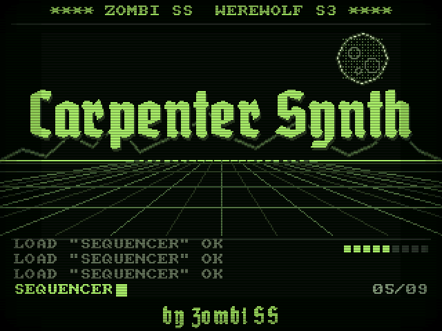

The xtro **Carpenter Synth** — seventeen modelled analogue-era engines (CS-80,
Minimoog, Prophet-5/10, ARP 2600/Odyssey, Mellotron, Oberheim SEM and OB-X,
Jupiter-8, System 100, Moog Modular, PPG Wave, MS-20, the real Dexed DX7,
String Ensemble, Prophet-VS), a 4-track 64-step sequencer with chains, 200
riffs and songs — moved onto the **werewolf**: an **ESP32-S3 with 16 MB
flash**, a **3.2" ILI9341 320×240 touchscreen** and a **PCM5102A DAC**.

What is carried over byte-for-byte from xtro `05d1933`: every engine, the
effects, the sequencer, presets, riffs, songs, the storage layout, the MIDI
parser and every UI action. What is new here:

* **The hardware layer** — I2S audio on its own FreeRTOS task on core 0, DIN
  MIDI on UART1, FAT storage (FFat), USB drive via TinyUSB, and a
  hand-written ILI9341 + XPT2046 driver (no display library, no
  `User_Setup.h`).
* **The panel** — a native 320×240 colour UI in the visual language of the
  *NightShift* owner's manual (lime for live data and the playhead, amber for
  the cursor and anything being edited, red for record/mute/destructive, the
  same frame on every page), dressed as a worn early-80s home computer: the
  Amstrad CPC's 8×8 ROM font with pixel-doubled titles, a CRT tube (scanlines,
  vignette, rounded glass), vector line art with phosphor glow, ordered-dither
  "crushed" shading, rubber keycaps and the four-stripe case badge. It replaces the xtro
  build's 128×64 OLED screens; the 80s-horror OLED redesign on
  `claude/ui-redesign-80s-horror` was only ever design renders, and it does
  not translate to a colour panel four times the size.
* **Touch** — a soft-key strip stands in for the xtro board's buttons, and
  every list row, grid step, pattern card, chain frame and mixer strip can be
  tapped and dragged directly. The xtro encoder and buttons still work if
  you wire them (all optional).
* **Splash** — the title card is set in **Grobe Deutschmeister**
  (`extras/font/GrobeDeutschmeister.ttf`, rasterized into
  `splash_wordmark.h` by `tools/ttf_to_xbm.py`).

| | |
|---|---|
| 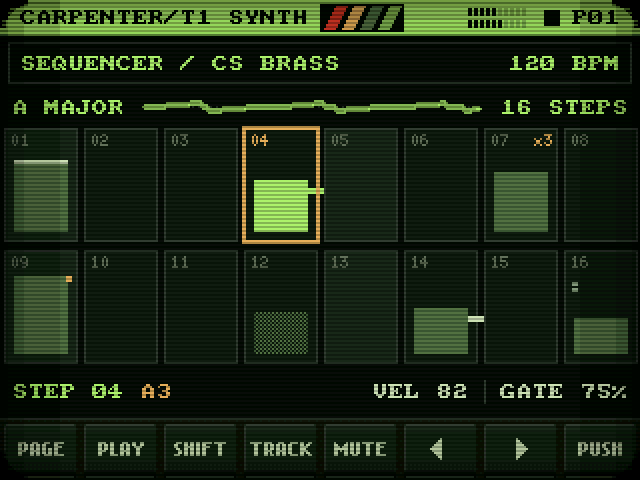 | 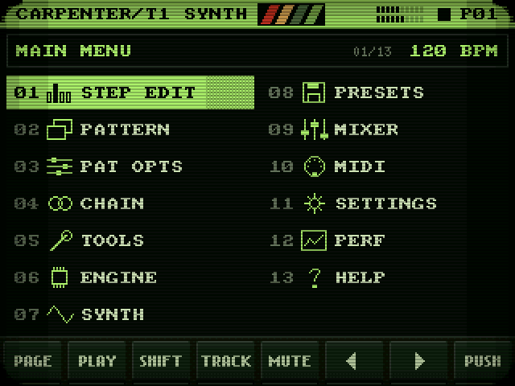 |
| 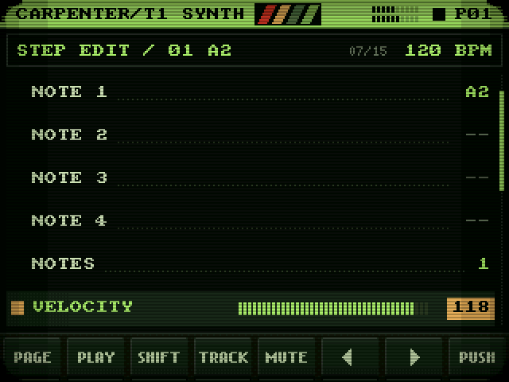 | 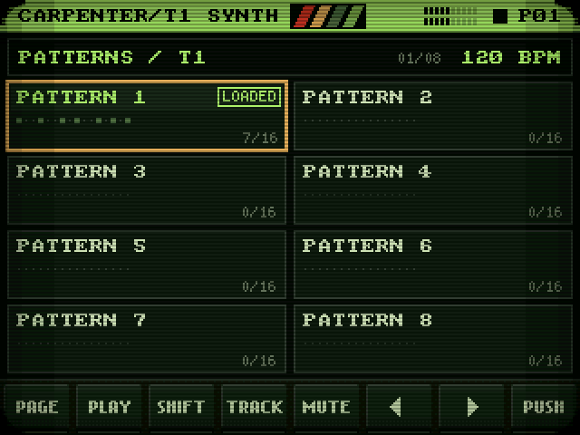 |
| 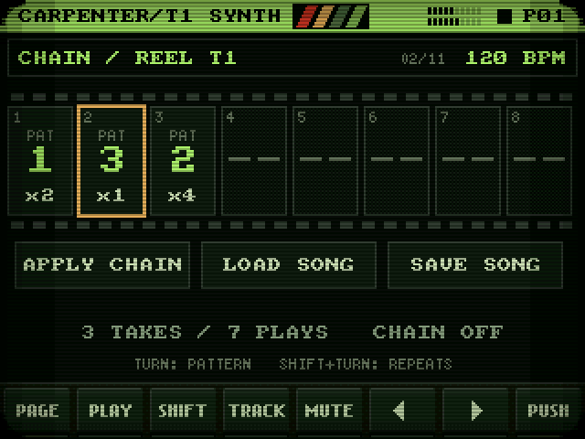 | 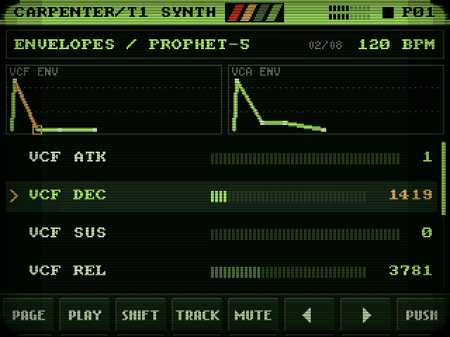 |
| 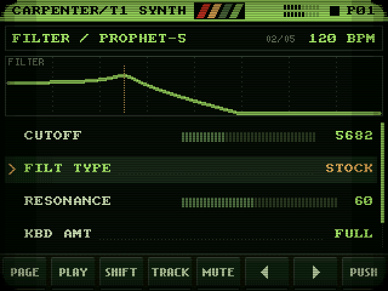 | 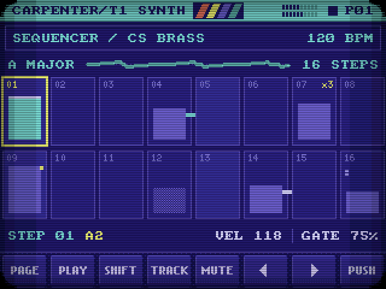 |
| 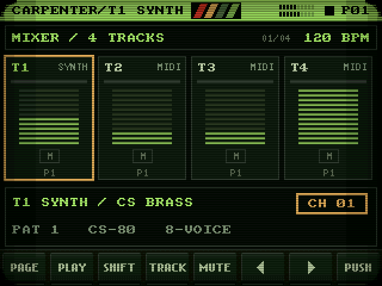 | 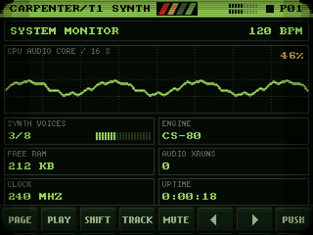 |
| 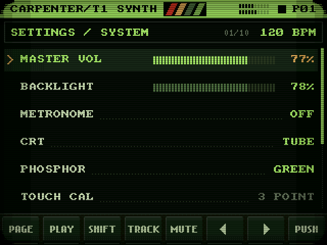 | 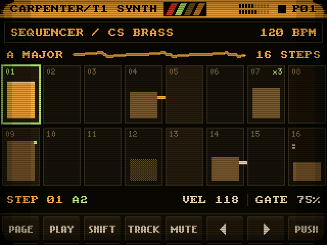 |

Every image above is the firmware's own `ui.cpp` and `gfx.cpp`, compiled on a
PC and dumped exactly as it would be sent to the ILI9341 — see
[Tools](#tools). They are not mockups.

---

## Status — read this first

* **Compiled, not yet run on hardware.** All three board configurations
  build cleanly with arduino-esp32 3.3.12 (`tests/build_s3.sh`), the
  seventeen-engine DSP test suite passes on the host under ASan/UBSan
  (`tests/run.sh`), and every screen renders correctly through the real UI
  code (`tools/preview/build.sh`). Nothing has been flashed to a werewolf
  yet, so the following have **not** been verified on the device:
  * **CPU headroom.** The engines were tuned on an RP2350 at 150–250 MHz;
    the S3's LX7 cores at 240 MHz should be in the same class, but the
    heaviest engines at full polyphony (CS-80's 16 paths, Prophet-10, the
    DX7) are the ones to check first on MENU → PERF. The CPU guard sheds
    voices rather than glitching, and **AUDIO XRUNS** counts any block
    that missed its deadline.
  * **The touch default and panel orientation.** Calibration runs on first
    boot, so the default mapping does not matter, but `TFT_MADCTL` in
    `config.h` may need changing for your module (see Troubleshooting).
  * **USB DRIVE** end to end on Windows/macOS/Linux (4 KB-sector FAT).
* **Needs PSRAM.** The delay lines, reverb, PPG wavetables and screen buffer
  live in PSRAM (the S3 has 320 KB of usable internal RAM against the RP2350's 520 KB,
  once the IDF takes its share). Use an **N16R8** module (16 MB flash, 8 MB
  octal PSRAM) — most "ESP32-S3 16 MB" dev boards are. A board without PSRAM
  stops at boot with **NO PSRAM - SEE README** on screen.

---

## Hardware

Target: **ESP32-S3-DevKitC-1 N16R8** (or any ESP32-S3 module with 16 MB flash
and PSRAM). The display, touch, DAC and MIDI pins are the ones the werewolf's
earlier ESP32-S3 build (`WerewolfAmyS3`) used, so an existing werewolf S3
harness needs no rewiring.

```
                     ESP32-S3 (N16R8)
                    ┌────────────────────────────┐
  TFT SCK    ───────┤ 12        ILI9341 on SPI2   │
  TFT MOSI   ───────┤ 11                          │
  TFT MISO   ───────┤ 13                          │
  TFT CS     ───────┤ 10                          │
  TFT DC     ───────┤  9                          │
  TFT RESET  ───────┤ 14                          │
  TFT LED    ───────┤ 21        backlight (PWM)   │
  T_CLK      ───────┤ 15        XPT2046 on SPI3   │
  T_DIN      ───────┤ 16                          │
  T_DO       ───────┤ 47                          │
  T_CS       ───────┤  8                          │
  T_IRQ      ───────┤  3        (wired, unused)   │
  I2S BCK    ───────┤  5        PCM5102A          │
  I2S LRCK   ───────┤  4                          │
  I2S DIN    ───────┤  6                          │
  MIDI IN    ───────┤ 18        UART1 RX (6N138)  │
  MIDI OUT   ───────┤ 17        UART1 TX          │
                    │                             │
  optional ─ ENC A/B/SW 39/40/41, PLAY 42, SHIFT 38,
             PAGE 7, TRACK 2, MUTE 1,
             OCT DOWN 0 (the board's BOOT button), OCT UP 46,
             metronome click out 43
                    └────────────────────────────┘
```

Avoid 26–37 (flash and octal PSRAM) and 19/20 (the native USB port).

### PCM5102A
| PCM5102A | ESP32-S3 |
|---|---|
| VIN | 3V3 |
| GND | GND |
| BCK | 5 |
| LCK | 4 |
| DIN | 6 |
| SCK, FLT, DEMP, FMT | GND |
| XSMT | 3V3 (unmute) |

### DIN MIDI
```
MIDI IN:   DIN 5 ──220Ω──► 6N138 pin 2        6N138 pin 8 ── 3V3
           DIN 4 ────────► 6N138 pin 3        6N138 pin 5 ── GND
           1N4148 across pins 2–3 (cathode to pin 2)
           6N138 pin 6 ──► GPIO 18, 4.7 kΩ pull-up to 3V3
MIDI OUT:  GPIO 17 ──10Ω──► DIN 5
           3V3     ──33Ω──► DIN 4
           DIN 2 ── GND
```

### Optional panel controls
Everything is reachable from the touchscreen alone. The xtro board's physical
controls can be added on the pins above — encoder and buttons to GND, internal
pull-ups, nothing else needed. Set any pin to `-1` in `config.h` if it is not
fitted; an unwired pin just reads "not pressed". The CUTOFF/RESONANCE pots are
**off** (`POTS_FITTED 0`): every ADC1 pin is in use above, and a floating ADC
pin would drift the filter. The same two parameters are on every engine's
FILTER page; `config.h` says which pins to free if you want the knobs.

---

## Building

**Arduino IDE** with Espressif's **esp32** core 3.x (tested: 3.3.12).

| Tools menu | Setting |
|---|---|
| Board | **ESP32S3 Dev Module** |
| Flash Size | **16MB (128Mb)** |
| Partition Scheme | **16M Flash (3MB APP/9.9MB FATFS)** |
| PSRAM | **OPI PSRAM** (N16R8) |
| CPU Frequency | **240MHz (WiFi)** |
| USB Mode | **USB-OTG (TinyUSB)** — needed for SETTINGS → USB DRIVE |
| USB CDC On Boot | **Enabled** — Serial on the same USB port |

With USB Mode on "Hardware CDC and JTAG" everything except USB DRIVE works;
the SETTINGS row says **OTG ONLY**.

**Two libraries**, one of which is vendored here:

1. **U8g2** (olikraus) — Library Manager. Only its fonts and glyph renderer
   are used; there is no OLED.
2. **Synth_Dexed** — the DX7 engine. Copy `extras/Synth_Dexed/` into your
   Arduino libraries folder as `Synth_Dexed`. This copy carries Pico2Dexed's
   RP2350 patches plus two small guards so the same files also build for the
   ESP32-S3; do not substitute an upstream Synth_Dexed.

No display, touch, MIDI or audio library is needed: TFT, touch, I2S, UART,
FAT and USB all come from the core. Put the files in a folder named
`CarpenterWerewolfS3/` and open `CarpenterWerewolfS3.ino`.

Current build figures (USB-OTG + PSRAM): 801 KB of the 3 MB app partition,
197 KB of static internal RAM, 130 KB internal heap left at link time.

### Licensing

**This firmware as a whole is GPLv3**, because of the DX7 engine: `Synth_Dexed`
is Holger Wirtz' MicroDexed layer (**GPLv3**) over Google's
*music-synthesizer-for-android* FM core (**Apache-2.0**). Both licence texts
ship with the vendored copy. **Grobe Deutschmeister** was supplied for this
build; its licence has not been checked here — confirm it allows embedding
before distributing binaries.

---

## First power-up

The title card comes up first and names each start-up stage on its status
line — `BOOTING → DSP TABLES → EFFECTS → STORAGE → SEQUENCER → MIDI → AUDIO →
READY` — with one heartbeat blip per stage. If start-up ever stops, the screen
says where.

1. **Touch calibration** runs automatically the first time (nothing is saved
   yet): tap the three amber crosses. It is stored in NVS, not on the FAT
   partition, so a safe boot or FORMAT FS never loses it. Redo it any time
   from SETTINGS → TOUCH CAL.
2. **READY (NO FS)** means the FAT partition has never been formatted: the
   synth plays normally but cannot save. SETTINGS → FORMAT FS, with SHIFT
   latched, then PUSH. It shows `FORMATTING FS...` and takes a while.
3. **Boot options** — hold a finger on the screen while powering up. The menu
   is chosen by *how long* you keep holding, not where you touch, so it works
   even with a wrong calibration: lift during the first band for a normal
   boot, the second for **SAFE BOOT** (skip storage, built-in defaults — the
   way back in if a save ever wedges the box), the third to **recalibrate**.
   Holding a wired SHIFT button at power-up is also a safe boot.

There is no watchdog, deliberately, same as xtro: the audio task can starve
core 0's idle task under full load, and a reset mid-song is worse than the
CPU guard shedding a voice.

---

## The panel


Every page has the same frame:

* **Top bar** — `CARPENTER / T1 SYNTH` (active track), L/R level meters (the
  last two segments go red near clipping), a blinking **REC** lamp while live
  record is armed, the transport (▶ / ❚❚ / ■) and the active track's pattern.
  The whole bar turns **amber** while that track is muted.
* **Title box** — page name and subject (`SEQUENCER / CS BRASS`), the row
  position (`03/13`) and the tempo, or `EXT SYNC` when slaved. Messages such
  as `PATTERN SAVED` flash across it in amber. **Tap it to go back.**
* **Content.**
* **Soft keys** — PAGE, PLAY, SHIFT, TRACK, MUTE, ◀, ▶, PUSH.

**Colours mean the same thing everywhere:** lime is live and primary (titles,
the playhead, running data); amber is the cursor — solid amber means you are
editing it now; red is record, mute or destructive.

**The step grid.** Sixteen steps of the active track in two rows of eight; bar
height is velocity, so a page reads as a loudness contour, and every fourth
cell is a shade lighter to mark the beat. Amber double frame = cursor, lime
frame = playhead, checkerboard bar = probability under 100 %, light cap =
accent, lime bridge = slide, light bridge = tie, amber `x3` = ratchet, amber
dot = parameter lock, small ticks = chord notes, dotted frame = past the
pattern's length. Page dots under the grid show which 16 of the 64 you are on.

**Lists** — the row marked `>` is selected; push to edit and the value turns
solid amber while the marker becomes a blinking block. Ranges get a segment
bar instead of a dotted leader. **PATTERN** shows one card per pattern with a
map of its steps; **CHAIN** is a strip of film with a frame per slot (the one
playing is outlined in lime) and APPLY / LOAD SONG / SAVE SONG buttons;
**MIXER** has a strip per track with an activity lamp, a density ladder and a
mute key; **PERF** graphs the audio core's load over the last 16 s.

**Vector graphics.** Line art is drawn with a one-pixel phosphor halo, like
a vector display's beam: the thirteen menu icons, a live **oscilloscope** of
the synth's output on the step-grid page (triggered on a rising zero
crossing so a held note stands still), the PERF load trace, and on SYNTH
pages two kinds of graph found automatically from the engine's own
parameter names — an **ADSR envelope** for every `<x> ATK / DEC / SUS / REL`
group on the page (the stage under the cursor in amber; CS-80 channel pages
get both VCA and VCF), and a **filter response curve** on any page holding
the engine's cutoff. The curve is a picture of the two knobs, not a
measurement of that engine's circuit. The boot screen is a vector landscape
— ridge, perspective grid, a wireframe full moon — over a console that
prints each start-up stage like a program loading from tape.

**SETTINGS** adds three panel rows: **BACKLIGHT**; **CRT** — OFF, LINES
(scanlines) or TUBE (scanlines, vignette and rounded corners; the default);
and **PHOSPHOR** — GREEN (the NightShift reference), AMBER, BLOOD, or MICRO
(blue glass, cyan and yellow, like an early-80s home computer).

### Touch

| Touch | Does |
|---|---|
| Tap a row / step / card / frame / strip | put the cursor on it |
| Tap what is already under the cursor | PUSH (open, or start/stop editing) |
| Drag up / down anywhere in the content | turn the encoder (one click per 14 px) |
| Hold a step on the grid | switch it on/off |
| Tap the title box | back (same as PAGE) |
| MENU items, SYNTH pages, CHAIN buttons | act on the first tap |

### Soft keys

Same short/long-press behaviour as the xtro board's buttons:

| Key | Press | Hold |
|---|---|---|
| **PAGE** | menu / back | **save everything** |
| **PLAY** | start / stop all tracks (in STEP EDIT: play the step) | toggle the step (grid) / stop everything |
| **SHIFT** | latches until the next action | — |
| **TRACK** | next track (in STEP EDIT: next step) | copy the pattern |
| **MUTE** | toggle the selected step | paste the clipboard |
| **◀ / ▶** | one encoder click; repeats while held | — |
| **PUSH** | encoder push | back |

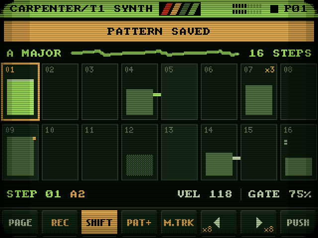

A resistive panel only reports one finger, so **SHIFT latches** instead of
being held: tap it (it turns amber and the other keys show their shifted
function in amber — PLAY→REC, TRACK→PAT+, MUTE→M.TRK, ◀▶ ×8), then do the
shifted action. It releases after any shifted key or push, but **stays on
through drags and ◀ ▶**, so SHIFT+turn (BPM on the grid, ×8 steps, the name
caret, chain repeats, riff category) works as one gesture. Tap SHIFT again to
drop it.

| With SHIFT | Action |
|---|---|
| drag / ◀ ▶ on the grid | tempo |
| drag / ◀ ▶ in lists | move / adjust ×8 |
| drag on a chain frame | repeat count |
| drag on the riff row | riff category |
| drag in the name editor | move the caret |
| PLAY | arm / disarm live record |
| MUTE | mute / unmute the track |
| TRACK | next pattern (in STEP EDIT: previous step) |
| PUSH in PRESETS | save to the user slot |
| PUSH in SONGS | delete that song |
| PUSH on FORMAT FS | format |

**Keyboard octave** — MIDI → **KBD OCTAVE** transposes an external MIDI
keyboard by octaves (−3..+3), leaving the sequencer's patterns alone. The
optional OCT DOWN / OCT UP buttons do the same; OCT DOWN is the dev board's
own BOOT button, so it works with nothing wired (just don't hold it while
powering up: that is the ROM's download mode).

---

## Sequencer

Four independent 64-step lanes. **Track 1 plays the internal synth** and echoes
to MIDI OUT; **tracks 2–4 are MIDI-only lanes** for outboard gear, each on its
own channel — that is what the DIN MIDI OUT is for.

### Per step
| Field | Range | Notes |
|-------|-------|-------|
| Active | on/off | |
| Notes 1–4 | 0–127 | **chords** — up to four notes per step |
| Note count | 1–4 | |
| Velocity | 1–127 | |
| Gate | 1–200 % | over 100 % overlaps into the next step |
| Probability | 0–100 % | |
| Micro | −50..+50 % | timing nudge off the grid, per step |
| Ratchet | ×1–×8 | retriggers inside the step |
| Accent | on/off | +30 velocity |
| Slide | on/off | legato overlap + portamento |
| Tie | on/off | holds through the next step |
| **P-locks ×4** | any parameter | per-step parameter automation |

**Parameter locks** are momentary: the first step to lock a parameter records
what it was, and everything is restored when the transport stops — a locked
pattern never silently rewrites the patch you saved.

### Per pattern
Length (1–64), swing (0–66 %), subdivision (1/16, 1/8, 1/4, 1/2, 1/32, 1/8T,
1/16T, 1/4., 1/8.), scale + root (16 scales, notes quantised on output),
transpose (±24), MIDI channel, time signature, and an optional linked synth
preset.

Each track picks its own subdivision and length, so a 64-step 1/16 lead can run
against a 12-step 1/8-triplet bassline — which is also what makes per-pattern
**time signature** work. 4/4, 3/4, 2/4, 5/4, 7/4, 6/8, 7/8, 5/8, 9/8 and 12/8
are offered as a Pattern Options field, but a time signature is a label plus a
*suggested* length (picking "5/4" sets length to 20 and nothing else) — the
sequencer only ever plays `length` steps at `subdiv` rate and always has, so
chaining patterns of different time signatures together (see Chain, below)
needed no new engine timing logic, just this label on top of what already
worked. Length can still be hand-tuned after picking a time signature.
SETTINGS → **Def Time Sig** sets what a newly-cleared pattern starts on.

### Tools page
Euclidean fill (hits + rotation), randomise within the pattern's scale,
humanise (velocity + micro-timing), a library of **200 riffs**, clear, copy
and paste.

Riffs are grouped into 5 categories — **Classic** (the original 24: house,
techno, trance, acid...), **Retrowave**, **Grindhouse**, **70s** and **80s**
(44 apiece for the new four) — so 200 is still fast to page through: turning
the encoder on the Riff row steps through the current category, SHIFT+turn
steps the category itself (ALL removes the filter).

### Chain
Up to 8 pattern slots with repeat counts, per track. Chained patterns keep
their own length, subdivision and time signature, so a chain can move from
4/4 into 7/8 and back mid-song exactly the way it can already move from a
16-step pattern into a 12-step one — it's the same mechanism (see Time
signature, above).

**LOAD SONG** / **SAVE SONG** rows at the bottom of the CHAIN page open the
song browser — see Songs, below.

### Songs
A song is a snapshot of all 4 tracks' chains, which pattern each is sitting
on, and the tempo — reachable from the Chain page's LOAD SONG / SAVE SONG
rows. **200 slots**, browseable as a scrollable list (SONG 001..200); SAVE
opens the same character-wheel name editor as a synth preset.

Songs are deliberately lightweight: they *reference* pattern slots rather than
embedding copies of their contents — the same trade-off the chain feature
already makes day to day, and it's what keeps 200 of them cheap (~90 bytes
each). The trade-off: editing a pattern changes it for every song that points
at that slot. That's a feature for a live set (fix a part once, every song
using it is fixed), not a bug, but it does mean a song is not a self-contained
archive of exactly how it sounded when saved, if patterns keep getting edited
afterward.

SHIFT + PUSH on a song slot deletes it.

### Sync
- **Internal**, with MIDI clock out (24 PPQN, plus start/stop/continue) from track 1 only.
- **External** — slaved to incoming MIDI clock. Every subdivision divides 6 ticks
  exactly, so the grid stays locked with no rounding drift, and clock out is
  suppressed while slaved so two boxes can't fight over the tempo.

### Live record
SHIFT+PLAY arms it. Notes from MIDI IN land on the nearest step; past the
halfway point they go to the step you are heading into.

### Metronome
A 6 ms gate pulse on the click output (GPIO 43, `PIN_CLICK_OUT`) at the top of
each beat — drives an LED or a click input without touching the audio path.

---

## Synth engines

Exactly **one engine is live at a time**, selected from `MENU → ENGINE` like
powering on a different instrument — not a per-note timbre choice. That keeps
the RAM budget to the size of the largest single engine (the Prophet-10's 10
voices) rather than the sum of every engine that will eventually exist, and
it matches how these machines actually existed: nobody plugged a CS-80 and a
Minimoog into the same keybed and got one instrument out of it.

Every engine implements the same free-function surface (`engine.h`) under its
own name prefix (`cs80*`, `mm*`, `p5*`, ...), dispatched by a
`switch (currentEngine)` in `engine.cpp` — switches, not virtuals, matching
the rest of this codebase's style. Each engine's own param array is
session-persistent RAM: switching away and back preserves whatever you'd
tweaked, same as leaving one real instrument's knobs alone while you play
another. Presets are namespaced by engine on the filesystem, since a
Minimoog patch's parameters mean nothing to a Prophet-5 — **28-31 curated
factory presets per real engine, plus 64 user slots per engine.**

| Engine | Voices | As heard in | Status |
|---|---|---|---|
| **Yamaha CS-80** | 8 x 2 channels | Fabio Frizzi (*Zombi 2*, *The Beyond*) | Full — 30 factory presets |
| **Minimoog** | 1 (mono) | John Carpenter, Claudio Simonetti (Goblin) | Full — 30 factory presets |
| **Sequential Circuits Prophet-5** | 5 | John Carpenter, Fabio Frizzi | Full — 29 factory presets |
| **Sequential Circuits Prophet-10** | 10 | John Carpenter | Full (shares the Prophet-5 circuit and its 29 presets, doubled) |
| **ARP 2600** | 1 (mono) | John Carpenter (*Halloween*, *Assault on Precinct 13*) | Full — 29 factory presets |
| **ARP Odyssey** | 2 (duophonic) | John Carpenter | Full (shares the ARP 2600 circuit and its 29 presets, duophonic) |
| **Mellotron** | 6 | Fabio Frizzi (*Zombi 2*, *City of the Living Dead*) | Full — 31 factory presets, Choir loop from a real recording — see below |
| **Oberheim Four-Voice / SEM** | 4 | John Carpenter | Full — 30 factory presets |
| **Roland Jupiter-8** | 8 | Claudio Simonetti (*Tenebre*) | Full — 30 factory presets |
| **Roland System 100 (101/102)** | 1 (mono) | Claudio Simonetti | Full — 30 factory presets |
| **Moog Modular System 55/III** | 1 (mono) | Dan Wyman (*Halloween*), Felice Fugazza (*Suspiria*) | Full — 31 factory presets — the wildcard, see below |
| **Oberheim OB-X** | 8 | Claudio Simonetti (Goblin) | Full — 31 factory presets |
| **PPG Wave 2.3** | 8 | Claudio Simonetti (Goblin) | Full — 28 factory presets |
| **Korg MS-20** | 1 (mono) | Claudio Simonetti (Goblin) | Full — 31 factory presets |
| **Yamaha DX7** | 8 | John Carpenter | Not modelled — runs the real Dexed/MSFA engine; 256 factory ROM voices on the BANK row (128 in the preset list) + up to 2048 more from `.syx` cartridges over USB DRIVE |
| **ARP/Solina String Ensemble** | 10 poly + 1 mono bass | John Carpenter | Full — 31 factory presets |
| **Sequential Prophet-VS** | 8 | John Carpenter | Full — 29 factory presets |

Every engine in the table above is fully modelled — there are no stubs left,
including the wildcard, the Simonetti/Goblin additions, and the four most
recent engines that round the roster out past subtractive analogue
polysynths entirely. `stub_engine.*` stays wired into `engine.cpp`'s
dispatch as a safety net (selecting any not-yet-built engine is always
silent, never a crash) in case an eighteenth engine is ever staged.

**CS-80**: two fully independent channels per voice (every note sounds
both), a frequency-independent-in-time sawtooth reset glitch, filters whose
damping floor never reaches zero (so they cannot self-oscillate — Q falls as
cutoff rises), an IL/AL/A/D/R filter envelope where decay can act as a
second slower attack, Hz/V pitch (not V/oct), a ring modulator swept by its
own envelope. See `engine_cs80.*`/`cs80_voice.*`/`cs80_params.*`.

The real instrument's two VCF sections don't share one exponential
converter: a technical teardown of the CS filter found the highpass section
tracking control voltage at 2V/octave against the lowpass section's standard
1V/octave, i.e. the HPF needs twice the CV for the same pitch-domain sweep
and so moves at half the LPF's rate for any shared modulation source. Every
one of those sources — the filter envelope, the LFO, Brilliance, per-voice
drift, velocity/aftertouch brightness — lands on one combined CV bus on the
real instrument, so this asymmetry is modelled where that bus is built
(`CS_HPF_TRACK_SCALE`, `config.h`), not duplicated per source: the two
CUTOFF knobs themselves stay independent, exactly as before.

**Minimoog**: three oscillators (six waveforms each) into a genuinely
self-oscillating 4-pole ladder filter (`ladder_filter.h`) — above ~95%
Emphasis it sustains its own tone with no input at all. Attack/Decay/Sustain
only on both contours (no Release — the real Model D panel has none), and
Oscillator Modulation (osc 3 or noise retunes osc 1/2 and/or the filter).

Two things the real Model D's own service literature and panel legends get
right that a generic 3-oscillator synth wouldn't: Oscillator 3's waveform
switch names its "Triangle/Sawtooth" position differently from Oscillators 1
and 2 — a plain **Reverse Sawtooth** (a mirrored downward ramp) rather than
the triangle-sawtooth hybrid the other two get in that same switch position
(`MMOsc::isOsc3` in `minimoog.h`). And the mixer itself — a CP3-style
discrete transistor stage — has its own soft "OVERLOAD" clipping, upstream
of and distinct from both the filter's own resonance-driven saturation and
the final output stage: a documented, audible layer of the "fat Moog" sound
that only shows up once the individual oscillator level knobs are run hot
enough to beat against each other. Modelled as a mild tanh stage on the
mixer sum, tuned to stay within a couple of percent of linear below ~30% so
single- or two-oscillator patches (most bells, plucks, leads) pass through
essentially unchanged.

**Prophet-5 / Prophet-10**: two DCOs mixing Sawtooth and Pulse
simultaneously, Oscillator B hard sync onto A (genuine sync, not FM), Poly-Mod
routing the filter envelope and Osc B into Osc A's frequency and/or cutoff
unscaled by the mod wheel, full four-stage ADSR on both filter and amp, and
Unison (fans one note across every voice, handled inside the engine itself
rather than the shared allocator). Oscillator B alone gets a third waveform
the real panel gives it and Oscillator A never had — **Triangle**
(`P5_OSCB_TRI`) — mixed in alongside its saw/pulse the same way.

Deliberately absent: any velocity or aftertouch sensitivity in the audio
path. The original Prophet-5/-10 keybed (Rev 1 through 3.x — everything
this engine models) had neither; every note plays at the same level no
matter how hard it's struck, and that didn't change until the 2020 Rev 4
reissue, a different, later instrument. MIDI velocity and aftertouch are
still accepted (so a sequencer or a modern controller can drive it) but
never reach amplitude or anything else — see `p5RenderBlockE` in
`prophet5.cpp`.

**ARP 2600 / ARP Odyssey**: three VCOs into a mixer, a self-oscillating
multimode state-variable filter (LP/BP/HP from one pass, selected by a mode
switch, matching the real 4072 filter's 3-way switch), a genuine 4-stage
ADSR on both filter and amp, a sample & hold fed from noise (patchable to
pitch and/or filter), and a ring modulator that multiplies OSC1 and OSC2
directly (no swept-sine carrier, unlike the CS-80's own ring mod). The
2600's filter damping floor reaches true zero — in deliberate contrast to
the CS-80's, which by design never does — which is what lets it
self-oscillate and scream the way a real 4072 does. The Odyssey shares the
identical voice circuit, just duophonic (2 voices) where the 2600 is
strictly mono — its panel really did add a switchable Duo/Mono mode the
2600 never had; see `arp2600.cpp`/`odyssey.cpp`.

**Mellotron**: not a synthesiser at all on the real instrument — a bank of
physical tape loops, one per key, started and stopped by a solenoid-and-
pinch-roller mechanism. This engine models the *mechanism*: playback is a
fixed recording resampled to pitch (not re-synthesised), Attack/Release are
the tape motor's spin-up/brake time rather than a VCA envelope shape (no
sustain *stage* — the tape just keeps running), and an independent Wow &
Flutter LFO models the pinch roller's own mechanical speed instability.
Regenerate `mellotron_samples.h` with `python3 tools/gen_mellotron_samples.py`
if you ever want to retune either loop.

The Choir loop is a **real recorded male choir sample**, not synthesis —
`tools/samples/choir_source.wav` (a trimmed 2.5 s excerpt of a user-supplied
recording), loop-crossfaded and downsampled to 11025 Hz 8-bit mono by
`gen_choir()` in `tools/gen_mellotron_samples.py`. Two things had to be
solved to turn a 44.1 kHz studio take into a seamless keyboard loop: (1) the
recording sings a short phrase rather than holding one note (autocorrelation
pitch-tracking found it moving C2 -> ~106 Hz -> F2 -> G2), so the loop
source is one steady segment (the G2 region — the longest stable span and
almost exactly standard pitch) rather than the whole take, since stacking
the keyboard's own pitch-shift on top of an already-moving pitch would make
every note sound like it was sliding; (2) a real recording has no built-in
seam the way the still-synthesised Strings loop's integer-Hz partials do, so
`_crossfade_loop()` blends the segment's tail into its own head before
handing it to the downsampler, landing the seam between two originally-
adjacent source samples instead of two arbitrary ones. `CHOIR_BASE_HZ`
(98 Hz, the measured G2) tells the engine what pitch the loop already plays
at so the keyboard tracks correctly.

Past its tape mechanism, this engine also gets a CUTOFF/RESONANCE/FILT TYPE
section (see Filter flavours, below) — a real M400 never had one, but it
gives the Mellotron the same live sound-shaping depth as every subtractive
engine here, which is what actually lets a session-recorded sample be
sculpted into new characters (bright, dark, filtered/resonant, even a
formant-filtered texture) from the panel rather than staying one fixed
tone. FILT TYPE's STOCK option (the default) means no filter at all, so
every existing preset's tone is untouched by this addition.

**Oberheim Four-Voice/SEM**: four independent SEM voice cards, each two
VCOs (sawtooth + variable pulse) into a 2-pole state-variable filter whose
mode sweeps **continuously** LP→Notch→BP→HP off a single MODE knob rather
than switching between fixed positions — a real SEM's most distinctive
trait, and something no other filter in this codebase does (every other
multimode filter here picks a mode, it doesn't blend through one). Real
Four-Voice units were four separately hand-tuned SEM cards, never perfectly
matched to each other, so each of the 4 voices here carries its own small
fixed detune/filter/level offset (`OB_VOICE_DETUNE/FILT/LEVEL`) — more
pronounced than the CS-80's own per-voice drift, since unit-to-unit mismatch
is a famous, audible part of the real instrument's character rather than an
incidental flaw to hide. See `oberheim.h`/`oberheim.cpp`.

**Roland Jupiter-8**: 8 voices, each two true VCOs (this predates Roland's
DCO-based Junos) with genuine audio-rate **cross modulation** (OSC2 into
OSC1's frequency), OSC2 able to swap its square wave for noise and drop into
a sub-audio LOW FREQ range for FM/pseudo-sample-and-hold effects, and a
resonant lowpass switchable between 12dB and 24dB slope (cascading the same
filter stage twice for the steeper setting — literally how the real
switched-slope circuit works). No built-in chorus — a common misconception
about the Jupiter-8 this engine deliberately doesn't repeat. See
`jupiter8.h`/`jupiter8.cpp`.

**Roland System 100 (101/102)**: deliberately just **one** melodic VCO —
the real 101 keyboard synth's second "voice" was never a second tunable
oscillator, so what plays alongside OSC1 here is a dedicated ring-modulator
operand whose own pitch is only ever a *ratio* off the main oscillator, plus
sample & hold fed from noise (patchable to pitch and/or filter, borrowing
the 102 expander's own extra modulation slot). The standout feature is a
second **non-voltage-controlled** highpass tone stage after the main
resonant filter — a plain fixed one-pole HPF with no envelope or
keyboard-tracking input reaching it at all, in deliberate contrast to every
other filter parameter in this entire codebase, matching the real 101/102's
separate VC-lowpass-plus-plain-HPF-knob signal path. See
`system100.h`/`system100.cpp`.

**Moog Modular System 55/III — the wildcard**: Dan Wyman scored *Halloween*
(1978) and Felice Fugazza scored *Suspiria* (1977) — the two films this
whole project is most directly named for and modelled around — on a real
Moog modular system, not a Minimoog, ARP or Oberheim, even though Carpenter
and Goblin/Simonetti's own studios had those too. This engine is that
missing link: the actual patchable 904A-filter/VCO lineage the Minimoog
already in this codebase is the compact, pre-wired, portable descendant of,
built here as a genuinely different instrument rather than "a bigger
Minimoog" — OSC2 hard-syncs OSC1 (the Minimoog has no sync at all), OSC3 is
a true audio-rate FM carrier into OSC1 (the Minimoog's OSC3 is a slow
modulator only, never an audio-rate one), a real ring modulator (OSC1×OSC2)
and sample & hold, and — the standout modular-only trick — the filter
envelope has a second destination knob (`FENV_TO_PITCH`) so one envelope can
patch to both the filter *and* pitch simultaneously, a genuine modular
"one envelope, two destinations" technique nothing else here models. Its
STOCK filter deliberately reuses the exact same `LadderFilter` the Minimoog
uses — the one case in this codebase where two engines share a "real
hardware" filter model, because the real Moog Modular's 904A filter module
*is* the circuit the Minimoog's ladder descends from. See
`moogmodular.h`/`moogmodular.cpp`.

**Oberheim OB-X**: Claudio Simonetti/Goblin's own credited rig — up to 8
voice cards, each 2 VCOs (sawtooth or variable pulse) into the SAME
12dB/octave state-variable filter design as this codebase's Four-Voice/SEM
engine (the real OB-X's own filter genuinely IS the SEM's SVF, discrete-
component, pre-dating the OB-Xa's later switch to Curtis chips), so it
reuses that filter verbatim rather than re-deriving an equivalent one — the
difference is the panel, not the circuit: OB-X wires only the LOWPASS
output, with no continuous mode-morph knob. What sets it apart from a
generic 2-VCO poly: CROSS MOD (audio-rate VCO2-into-VCO1 FM, the original
OB-X's own panel feature before the OB-Xa replaced it with something else),
a genuinely polyphonic sample & hold (each voice draws its own independent
random value, not one shared value copied to all), and — the standout,
name-checked-twice-in-period-documentation feature — a HOLD "unison chord"
mode: hold a chord, let go, and it's memorized; the next single key
transposes and replays the whole shape, repeatably, for one-finger stabs.
Built entirely at the engine level, the same way this codebase's Prophet-5
UNISON bypasses the shared voice allocator. See `obx.h`/`obx.cpp`.

**PPG Wave 2.3**: also Claudio Simonetti/Goblin's own credited rig, and the
one engine in this entire codebase that isn't an analogue-oscillator
design: 8 voices, 2 DIGITAL wavetable oscillators per voice feeding an
ANALOGUE SSM2044 4-pole lowpass and CEM3360 VCA — a genuine hybrid signal
path. Modelled to the real format's own exact numbers: each "wave" is a
single-cycle waveform 256 samples long, and 64 of them make up one
wavetable that the oscillator continuously scans through at a WAVE POSITION
that can sweep in real time — the real unit shipped 30 such tables; this
engine generates 3 procedurally at boot (a brightness sweep, a two-formant
vowel-ish sweep, and a pulse-width sweep) rather than reproducing an actual
ROM dump, which isn't available here. Three independent envelope
generators, not two: full ADSRs for filter and amp, plus a dedicated
simpler AD envelope ("Env3" on the real panel) whose only job is sweeping
the wave position — nothing else here has a modulation source dedicated to
one destination like that. No anti-aliasing of the wavetables, ever,
deliberately — the real PPG's fixed 256-sample tables alias at high
pitches, and that grainy digital top end is a well-known, embraced part of
the instrument's character, the same design choice this codebase's CS-80
makes for its own un-band-limited reset glitch. See
`ppgwave.h`/`ppgwave.cpp`.

**Korg MS-20** — the vintage Korg mono synth pick: a genuinely aggressive
patchable mono synth built from two separate filter sections in series
(a 6dB HPF and a 12dB LPF, not one multimode filter), both able to
self-oscillate on their own. EG1 is normalled to both VCOs' pitch; EG2 is
normalled to *both* the filters' cutoff *and* the VCA together — one shared
envelope for filter and amp, not two independent ones, the real panel's own
economy. Both envelopes have a genuine post-release **HOLD** stage: on
note-off the envelope freezes at its current level for a fixed time before
actually releasing, "like holding a sustain pedal" — nothing else in this
codebase's envelopes does that. VCO1 hard-syncs VCO2 (the direction flipped
from every other synced engine here), and VCO2's own wave switch has a
**RING MOD** (VCO1×VCO2) position as a third waveform choice, not a
separate mix knob. Deliberately not modelled: the real ESP (External Signal
Processor, an audio-in pitch/envelope tracker) — there's no audio input
path on an all-digital instrument. See `ms20.h`/`ms20.cpp`.

**Yamaha DX7** — this codebase's only FM (phase-modulation) engine, the one
instrument here not built from oscillator→filter→VCA at all, and the **only
one that is not modelled**. It drives the real thing: **Dexed**, itself built
on Google's *music-synthesizer-for-android* FM core — the same engine
MiniDexed and Pico2Dexed run — through the vendored `Synth_Dexed` library in
`extras/Synth_Dexed/`.

That is a deliberate reversal of this project's usual approach, and the
reason is specific to the instrument. Every other engine here is an
**analogue** machine, where a documented topology can be modelled and judged
by ear against the records. The DX7 is a **digital** machine whose sound *is*
its exact fixed-point arithmetic — operator phase accumulation, the EGS
chip's rate/level envelope curves, the log-domain sine and exp2 tables. An
approximation of those numbers is not a slightly-less-accurate DX7; it is a
different synth. The hand-rolled 6-operator engine that used to sit here was
exactly that, and it is gone.

What the real engine brings over it:

* **All 32 algorithms**, not 8 representative shapes.
* **Real DX7 envelopes** — four independent Rate/Level pairs per operator
  with the actual level-scaling table and rate scaling, not a 4-knob ADSR
  standing in for them.
* **Keyboard level scaling** (breakpoint, left/right depth and curve),
  keyboard rate scaling, velocity sensitivity and amp-mod sensitivity, per
  operator — everything that makes a DX7 patch respond to *where* and *how
  hard* it is played, none of which the approximation had.
* **The factory library**: all 8 ROM cartridges × 32 voices = **256 real
  voices** (`dx7_rom.h`) — E.PIANO 1, TUB BELLS, BASS 1 — instead of
  hand-written imitations of them.
* **Real cartridges from a real drive**: SETTINGS → USB DRIVE (see
  *Storage*, above) exports the filesystem so `.syx` files can be dropped
  into `/banks` — up to `MAX_FS_BANKS` (64 by default) more 32-voice
  cartridges on top of the 256 in ROM, picked up on the BANK row the moment
  the drive is ejected.

What it costs: the patch model here is *a cartridge voice plus edits*, not a
freely-designed patch saved whole. A DX7 voice is 155 bytes and this
codebase's preset/step-lock system stores 90 bytes per patch, so a preset
records **which** cartridge voice, plus the panel rows listed below — not an
arbitrary edited voice. The panel is BANK, VOICE, the six operator output
levels, ALGORITHM, FEEDBACK, the full LFO page, the full pitch EG, and
TRANSPOSE/TUNE/MONO/PORTA/BEND — every one a real DX7 parameter with an exact
Dexed setter, and all of them read back from whichever cartridge voice is
loaded, so the panel shows the patch rather than wherever the knobs were left.

The engine itself never touches the filesystem: BANK reaching past ROM goes
through three function pointers (`dxExtBankCount`/`dxExtBankName`/
`dxExtGetVoice`, wired to `voicebank.cpp`'s real functions once at boot) that
sit null — reachable only 0..7 — anywhere that hasn't wired them up,
including the host tests. Turning BANK past whatever's actually plugged in
lands on a harmless dead position (shown as `--`) rather than silence or
garbage; the same "keep the current sound" rule covers a cartridge whose file
was deleted after a preset was saved pointing at it.

Polyphony is 8, against the real machine's 16: Dexed's per-note cost on
RP2350 was the binding constraint on the xtro board, and the S3 is untested
at full load (see Status). The CPU guard lowers it further under load
like any other engine. There is no filter, deliberately — the real DX7
doesn't have one either, which is also why the front-panel CUTOFF/RESONANCE
pots are inert on this engine (see **Hardware controls**). See
`dx7.h`/`dx7.cpp`.

> **One real bug was found and fixed on the way in.** MSFA's `Env::update()`
> jumps a held note's envelope straight to its sustain level (upstream,
> verbatim: *"for now we simply reset ourselves at level 3"*), and Dexed runs
> that refresh at the top of `getSamples()` whenever a voice load or a
> parameter write has armed it. A note started in that window skips its
> attack and decay and **begins at its sustain level** — which for every
> percussive DX7 patch (piano, bass, clav, harpsichord, bell, pluck) is zero,
> i.e. the note is silent. Measured across the whole factory library on the
> host: **93 of the 256 ROM voices produced no output at all.** The fix is
> `DxAdapter::settle()` in `dx7.cpp` — clear the pending refresh when nothing
> is playing, so a stale one can never sit armed across a note-on — and
> `testDx7EveryRomVoiceSounds` in `tests/test.cpp` locks it down. Anything
> else driving this Dexed build (including the MedusaDexed project this port
> came from) has the same bug.

**ARP/Solina String Ensemble** — the one engine in this codebase built on
organ-style **divide-down** technology (12 master oscillators and octave
dividers) rather than a bank of individually-tuned VCOs, matching how the
real 1974 string machine actually generates pitch. All of its character
comes from six fixed, individually-level-controlled instrument voicings —
Violin, Viola, Trumpet, Horn, Cello, Contrabass — each its own fixed
one-pole tone colour, not a player-adjustable filter (a real M400 has no
filter of any kind; a non-STOCK FILT TYPE row is still offered as an
optional bonus, the same trade this codebase's Mellotron already makes),
plus a three-line modulated-delay ensemble/chorus effect that *is* this
instrument's sound, not a bypassable post-effect — it runs before and in
addition to the shared chorus/delay/reverb chain every engine already has.
Cello and Contrabass are genuinely different from the other four voicings:
**monophonic**, restricted to the keyboard's lowest keys, driven by
whichever held note in that range is currently lowest — a bass coupler
built entirely at the engine level with its own held-note stack, the same
technique this codebase's Prophet-5 UNISON and OB-X HOLD already use to
bypass the shared voice allocator (see `testStringEnsembleBassCoupler` in
`tests/test.cpp`). The simplest envelope in this whole codebase — just
Attack ("Crescendo") and Release ("Sustain Length"), no decay or sustain
*level* stage at all, since the real panel doesn't have one either. No
glide, either: an organ-style divide-down instrument has no VCO to slew.
See `stringens.h`/`stringens.cpp`.

**Sequential Prophet-VS** — this codebase's only **vector-synthesis**
engine: 4 digital oscillators (A/B/C/D) per voice, each one of 5 waveform
types (the real 1986 flagship reads 127 stored single-cycle waveforms per
oscillator; this engine models the waveform *types* rather than that
library), mixed not by four independent level knobs but by **one shared
X/Y position** inside a diamond with the four oscillators at its corners,
crossfading all four simultaneously via bilinear interpolation — the one
property that actually defines vector synthesis, and the real joystick's
own "diamond" mixing law, preserved exactly. A dedicated **vector
envelope** can move that same position on its own after a note starts,
through two waypoints with an optional loop — the real instrument's own
third envelope generator ("oscillator mix") doing a job no other envelope
in this codebase does: animating a 2D position, not a single scalar. An
LFO can also wobble the vector position directly for an automatic
timbral crossfade, alongside the ordinary vibrato route. Genuine analogue
filtering (a Curtis CEM3372-family resonant lowpass) on those fully
digital oscillators is the same *hybrid* signal-path category as this
codebase's PPG Wave, but an unrelated real chip and an unrelated
oscillator technique (bilinear vector-crossfade of fixed waveforms, not a
scanned wavetable). Voice count is 8, an exact match to the real
instrument — no `MAX_VOICES` compromise needed here, unlike the DX7. See
`prophetvs.h`/`prophetvs.cpp`.

**Filter flavours**: Minimoog, Prophet-5/10, ARP 2600/Odyssey, the
Mellotron, Oberheim Four-Voice/SEM, Jupiter-8, System 100, the Moog
Modular, OB-X, PPG Wave 2.3, the MS-20, the String Ensemble and Prophet-VS
each get a **FILT TYPE** row on their FILTER page — 16 options:
STOCK (that engine's own modelled filter, or for the Mellotron and String
Ensemble — which never had one — simply no filter at all, the source played
exactly as modelled) plus 15 alternate character models (Moog ladder, MS-20,
Oberheim SEM SVF, TB-303, Prophet/SSM2040, Juno/IR3109, ARP 4072,
Steiner-Parker, Sallen-Key, CEM3320, a CS-80-inspired tilt, a series MS-20
HP→LP, a formant/vocal triple-peak, a darker diode ladder, and an SVF whose
RESONANCE morphs LP→BP→HP). CUTOFF and RESONANCE keep doing exactly what
they already did, just through a different topology. See
`variable_filter.h`. (CS-80 and DX7 don't get this — the CS-80's filter is
the original build's code, kept verbatim, and the real DX7 has no filter of
any kind to begin with — see above.)

**Retired with the old single-engine build**: the "ZOMBI SS" patch-bay mode
(named for the System 100, but a graphical front end onto that one engine's
fixed LFO-dest/ring-mod/hard-sync/filter-mode routing) — there's no
equivalent shape on a CS-80 or a Minimoog, so it did not carry forward. The
System 100 *engine* above is unrelated and unaffected — a new model of the
real instrument, not a revival of that old UI.

---

## Optimisation notes (from the xtro build)

These principles were true of the original single-engine build and remain
true of `dsp_tables.cpp`/`fx.cpp` (shared by every engine) and of each
engine's own render path — `renderBlock()` in the sketch is now a thin
dispatcher (drain the note queue, call `engineRenderBlock()`, measure the
result), with the actual per-voice hot path living inside whichever engine
is current (`engine_cs80.cpp`, `minimoog.cpp`, ...), not in the sketch:

**No transcendentals on the audio path.** Sine, tanh and the filter coefficient
all come from tables built into SRAM at boot. `sinf`, `expf`, `tanf`, `powf` and
`sqrtf` are called at boot and at control rate only.

**Cutoff lives in the log domain.** The filter takes a table *index*, not hertz.
An octave of envelope, keytracking, velocity or LFO is then just
`+= FILT_IDX_PER_OCT` — pitch-domain modulation with no `pow()` anywhere.

**Two rates.** Oscillators, filter and amp envelope run per sample; glide, phase
increments, the filter envelope and coefficient recomputation run at
48 kHz / 8 = 6 kHz. Coefficient recomputation was the single largest cost in the
original build (an `expf()` per voice *per sample*).

**Bit masks, not modulo.** Every ring buffer — delay, chorus, sine table, voice
queue — is a power of two, so wrapping is one `AND`.

**Parameters are snapshotted per block**, not read as volatiles inside the sample
loop.

**Automatic overload guard.** The audio task measures its own render time. Above 90 % it
sheds a voice; below 65 % it takes one back — down to the CS-80's floor of 1
voice, since a 1-voice engine (Minimoog) needs to be able to shed to exactly
that. Clicks are worse than a stolen voice. The PERF page shows measured CPU,
live voice count, free RAM and clock.

**Effects are one shared instance, not one per engine.** Chorus/delay/reverb
together are ~108 KB; only one engine ever renders at a time (see
[Synth engines](#synth-engines)), so `g_fxChorus`/`g_fxDelay`/`g_fxReverb`
(`fx.h`) are shared globals every engine calls `.begin()` on when it
activates, rather than each engine owning a private (and mostly idle) copy.

The single-engine build's own history of bugs found and fixed in its
`renderBlock()` — a stereo-detune double-render, a ladder-filter highpass
precision collapse, Master Volume baked into the saturator, a mono/poly
mode-switch voice leak — lives in this repo's git history along with that
engine's code; none of it applies to the current multi-engine build. The
Master-into-the-saturator bug in particular recurred independently in each
newly-ported engine and was fixed the same way in each: a fixed drive
constant sized from that engine's own hottest stock preset (`CS_MIX_DRIVE`,
`MM_MIX_DRIVE`, `P5_MIX_DRIVE`, ...), with Master applying as pure linear
gain *after* the saturator — see `testMasterIsLinearPostSaturationGain` in
`tests/test.cpp`.

**One RP2350-side bug found in this port itself, not inherited from the
ESP32 source: Minimoog's oscillators and self-oscillating ladder filter ran
unconditionally, even with no note held.** Every other engine here
(Prophet-5/10, CS-80, Mellotron) skips a fully-idle voice's oscillator/
filter work outright (`if (!alive) { va.busy[i] = 0; continue; }`) — Minimoog's
port was missing that skip, so between notes its ladder filter kept being
driven by the still-running oscillators at whatever Emphasis was dialled in,
with nothing ever giving it a rest. Once Emphasis got anywhere near the
self-oscillation threshold this built into an audibly distorted, glitchy
tone with no way back to silence short of a full engine switch (which
reconstructs the voice from scratch) — reported as "sounds distorted,
stopping and restarting the pattern doesn't really fix it." Fixed in
`minimoog.cpp` to match the pattern every other engine already uses.

**A second, unrelated bug found in every engine's INIT patch and factory
presets, also inherited from the ESP32 source rather than introduced by this
port: enum/toggle parameters set to a literal option index instead of a
properly scaled raw byte.** Every `*Decode()`/`*FormatParameterE()` in this
codebase reads a `PK_ENUM`/`PK_TOGGLE` parameter as a *proportion* of the
0..127 (or, for CS-80, 0..255) raw range, not as a direct index —
`i = (int)(raw/max * numOpts)`. A preset author writing the literal index
(e.g. `2`, meaning "the third option") instead of a value scaled into that
option's slice of the range gets back option 0 almost every time, since a
small literal like `2` is a tiny fraction of any range wider than one or two
steps. Reported as "the presets are all screwed up with the Moog... all set
to 32 on octave" — confirmed exactly: Minimoog's `MM_INIT` set every
oscillator's octave field to raw `2` intending `"8'"` (index 2 of 5), which
decoded to `"32'"` (index 0) instead. The same pattern turned up well beyond
Minimoog and well beyond octave: Prophet-5's default keyboard-tracking
amount, several presets' Poly-Mod/Ring-Mod/oscillator-sync toggles silently
staying off because a literal `1` (0.8% of 127) never crosses the toggle's
`>0.5` threshold, ARP 2600's `OSC2 TRACK` defaulting off so oscillator 2 sat
at a near-0 Hz fixed pitch instead of tracking the keyboard, and a related
but distinct mistake on the *same* Minimoog INIT patch — `OSC2/3 FINE`
(a continuous ±700-cent bipolar knob, not an enum) set to a value that
implicitly assumed the CS-80's 0..255 raw convention instead of this
engine's actual 0..127 one, detuning oscillator 2 almost a tritone sharp of
oscillator 1 by default. `param_types.h` now defines `EI(idx, n)`, a
compile-time macro returning the raw byte at the center of option `idx`'s
bucket out of `n` options — chosen so it round-trips through the decode
formula above regardless of `n` — and every engine's INIT patch and factory
preset table was rewritten with it (and, for continuous knobs like `FINE`,
with a value actually checked against what it decodes to) rather than
patched around. See `param_types.h`'s comment above `EI()` for the exact
reasoning, and use it for any new preset content going forward.

**A third bug, caught in review before ever reaching the board: the Moog
Modular wildcard's oscillators didn't advance.** Every oscillator elsewhere
in this codebase follows one of two conventions — a self-contained
`next(wave)` that advances phase and returns a waveform value in one call
(CS-80), or an explicit `advance()` that increments phase and returns `t`,
consumed by separate `tri(t)/saw(t)/pulse(t)` methods (every engine ported
since). `Mm2Osc`'s first draft was a broken hybrid of the two: `next(wave)`
only *read* the existing phase without ever incrementing it, while a
separate, half-used `advance()` sat alongside it — so calling `next()` alone
(as the render loop did for OSC1 and OSC3) froze that oscillator at a
constant value forever, and OSC2's one `advance()` call before its own
`next()` didn't help, since `next()` still never advanced past whatever
`advance()` had already produced. All three oscillators combined would have
sounded like an inert three-note dial-tone. Fixed by merging both methods
into one self-contained `next(wave, wrapped=nullptr)` matching the CS-80
convention, caught during a code-review pass comparing every new engine's
oscillator shape against every prior one, before the wildcard was ever
committed.

**A fourth bug, reported directly: most of the 200-riff library wasn't 200
distinct riffs.** The Retrowave/Grindhouse/70s/80s categories (44 riffs
apiece) were each built from only 4-5 truly unique 16-step note/velocity
patterns, cycled through 11 renamed groups — e.g. every one of NEON DRIVE,
NIGHT RACER, CHROME EDGE, SUNSET GRID, TURBO, ARCADE GLOW, NIGHT CITY, LASER
HIGHWAY, VELOUR and RETROGRADE was byte-for-byte the same four riffs as
OUTRUN, just relabelled. Only the 24 Classic riffs were actually all
distinct. Fixed by regenerating all 176 with genuinely independent note
shapes, accent contours and gate values per category (`tools/gen_riffs.py`,
not shipped on the board — a one-off content-generation script, not part of
the build), verified programmatically to have zero repeats at every level
(notes, notes+velocity, and the full riff) both within each category and
across all 200, while keeping every existing name, category and the total
count unchanged. One thing that check caught along the way: because note
shape and velocity contour are now chosen independently instead of as a
hand-paired set, a few riffs would have landed a real (non-rest) note on a
step whose paired velocity contour happened to carry a 0 there, silently
dropping that note — fixed with a downbeat-weighted fallback accent so
every sounding step always has an audible velocity.

---

---

## Storage

FAT on the ESP32-S3's flash (arduino-esp32's **FFat**, on the 9.9 MB `ffat`
partition — not LittleFS, so the partition can also be exported over USB).
The layout is xtro's unchanged: patterns per track in `/patterns/`, settings
(including which engine was live and its patch) in `/settings.bin`, user
presets in `/presets/` namespaced by engine (`e<id>_u<slot>.bin`), songs in
`/songs/` (200 slots), DX7 cartridges in `/banks/`. `STORAGE_VERSION` is 7
here (the settings gained the panel's PHOSPHOR and CRT), so files from
an xtro board are rejected rather than misread — same policy as every bump.

Hold **PAGE** to save everything. `Storage::begin()` mounts but never formats;
formatting is the explicit, on-screen SETTINGS → FORMAT FS. A flash write
disables the S3's cache on both cores, so the audio task parks itself at a
clean block boundary around every write: audio pauses briefly during a save
rather than glitching mid-block.

### USB DRIVE — drag-and-drop DX7 voice banks

SETTINGS → **USB DRIVE** (needs Tools → USB Mode → USB-OTG) stops the
transport, silences the engine, and hands the FAT partition to the computer on
the USB cable as a plain memory stick. Drop DX7 `.syx` cartridges (32 voices,
4104-byte SysEx or 4096-byte raw) into `/banks`, eject on the computer, press
**PAGE**, and they appear on the DX7's BANK row after the 8 ROM banks (up to
`MAX_FS_BANKS`, 64 → 2048 extra voices).

How it works on the S3: FFat keeps its wear-levelling handle private, so the
sketch unmounts FFat and mounts the same partition's wear-levelling layer
itself (the IDF's `wl_*` API), serving the host 4 KB sectors — exactly the
sectors FFat uses. On eject (or PAGE) it unmounts that and FFat mounts the
partition again. While the computer has the drive, every filesystem access in
the firmware refuses to run (`g_diskMode`); the sequencer keeps going.

---

## MIDI

- **DIN IN on GPIO 18, OUT on GPIO 17**, 31250 baud, on the S3's UART1.
- Note on/off, CC, program change (loads that engine's factory preset), pitch
  bend, polyphonic + channel aftertouch, and 24-PPQN clock with
  start/stop/continue, in and out.
- Input channel filter (omni or 1–16), soft thru, a **Kbd Play** on/off
  switch, a **KBD OCTAVE** transpose for an external keyboard, and a PANIC entry
  on the MIDI page.
- **An external MIDI keyboard on MIDI IN plays the internal synth engine
  live** — "Local Control" in conventional synth terms — whatever engine is
  currently selected, independent of the sequencer's transport or record-arm
  state. **Kbd Play** (MIDI SET page, on by default) is the on/off switch for
  this: turning it off silences that live monitoring without touching MIDI
  thru or step-recording (SHIFT+PLAY still captures incoming notes into the
  active track either way), and turning it off mid-note can never strand a
  voice sounding, since it only gates a NEW note-on — the matching note-off
  always goes through. Set **In Chan** to the keyboard's own transmit channel
  (or leave it on OMNI, the default) if notes aren't reaching the synth.
- **Every synth parameter has a CC**, resolved through the live engine's own
  parameter table (`ParamInfo::cc`, `param_types.h`) — same source the UI
  reads, so the map and the editor can never drift apart. Reserved
  controllers (0/32 bank, 6/38 data entry, 64 sustain, 98–101 RPN/NRPN,
  120–127 channel mode) are avoided; where the GM2 meaning matches, the
  standard number is used.
- CC 1 is the mod wheel; CC 64 is a real **sustain pedal**; CC 120/123 are
  all-notes-off. All three are handled before the per-engine CC lookup, so
  they always work regardless of which engine is live.
- **Sustain (CC 64, ≥64 = down)** works the way a normal synth's does:
  releasing a key while the pedal is held keeps that note ringing, and it
  actually stops when the pedal itself comes back up — not per-engine DSP,
  since that's a note-ROUTING behaviour, implemented once for whichever
  engine is live rather than in all seventeen of them. A key pressed again
  while the pedal is still down retriggers normally and re-takes ownership of
  its own release from the pedal. PANIC and CC 120/123 (all-notes-off) both
  clear any notes that were only still ringing because of the pedal, same as
  everything else they silence.

### CC map is per engine, not one global table

Each engine defines its own parameters and CC numbers in its own source file
(`cs80_params.cpp`, `minimoog.cpp`, `prophet5.cpp`, `prophet10.cpp`,
`arp2600.cpp`, `odyssey.cpp`, `mellotron.cpp`, `oberheim.cpp`,
`jupiter8.cpp`, `system100.cpp`, `moogmodular.cpp`, `obx.cpp`,
`ppgwave.cpp`, `ms20.cpp`, `dx7.cpp`, `stringens.cpp`, `prophetvs.cpp`) —
there is no longer one fixed CC table shared by every sound, since a
Minimoog has a completely different panel from a CS-80.
To find a given engine's exact CC numbers, read that engine's own
`PARAM_INFO[]` table in source (the `cc` column). Every engine's last 8 parameters are
the same arpeggiator tail (ENABLE, PATTERN, RATE, GATE, OCTAVES, DIR, LATCH,
SYNC, in that order — see `ARP_TAIL_COUNT` in `engine.h`), so the arp CCs
are the same shape on every engine even though their exact numbers can
differ.

---


USB MIDI is not implemented: the native USB port carries Serial and the USB
drive. (arduino-esp32 has a class-compliant `USBMIDI` that could be added
alongside them.)

---

## Tools

* **`tests/run.sh`** — builds and runs every engine's DSP, the effects, the
  sequencer and the DX7 ROM checks natively under ASan + UBSan. Unchanged from
  xtro apart from host-side shims; all tests pass on this port.
* **`tests/build_s3.sh`** — compiles the whole sketch with arduino-cli for the
  ESP32-S3 in the three board configurations that change what is compiled
  (USB-OTG + PSRAM, Hardware CDC + PSRAM, no PSRAM).
* **`tools/preview/build.sh`** — links the real `ui.cpp`, `gfx.cpp`, the
  sequencer and all seventeen engines on a PC, drives each screen into place
  through the same input events the touchscreen and buttons use, and writes
  what would have been sent to the ILI9341 to `tools/preview/out/*.png`. The
  screenshots in this README are its output. Needs g++, Python 3 + Pillow;
  fetches U8g2's C sources on first run.
* **`tools/ttf_to_xbm.py`** — renders fixed strings from a TTF into XBM
  bitmaps; `splash_wordmark.h`'s banner has the exact command used for the
  Grobe Deutschmeister title and byline.

### How the panel is drawn

`gfx.h` is a 16-colour, 4-bit-per-pixel 320×240 canvas (38 KB). Text and line
primitives are not reimplemented: U8g2's C core is set up as a 320×240
"display" whose low-level line callback writes into the canvas in the current
palette colour, so every `u8g2_font_*` bitmap font is available with no second
font engine. Each frame the whole UI is redrawn into the canvas, and
`flush()` hashes each 8-row band and only sends the bands that changed — a
moving playhead costs two or three bands of SPI traffic, a still page none.
The CRT effect is applied at that point too, so the canvas stays clean:
every palette colour is precomputed at eight brightness levels, and each
pixel goes out at the level its position asks for — odd rows at 76 % (the
exact ratio between each lit colour and its scanline partner on the
NightShift reference screens), falling off toward the tube's edges, black
outside the rounded corners. Text is U8g2's Amstrad CPC font; 2× titles are
the same glyph runs stretched in the line callback (`textScaled()`).

---

## Troubleshooting

| Problem | Check |
|---|---|
| Blank / white screen | TFT wiring (SCK 12, MOSI 11, CS 10, DC 9, RST 14, LED 21); some modules need `TFT_INVERT 1` in `config.h` |
| Picture upside down | `TFT_MADCTL` in `config.h`: `0xE8` ↔ `0x28` (then redo TOUCH CAL) |
| Red and blue swapped | clear the `0x08` bit in `TFT_MADCTL` |
| Touch lands in the wrong place | SETTINGS → TOUCH CAL, or hold the screen at power-up and lift on TOUCH CALIBRATION |
| Touch does nothing | T_CLK 15, T_DIN 16, T_DO 47, T_CS 8; raise or lower `TOUCH_Z_MIN` |
| `NO PSRAM - SEE README` | the module has no PSRAM, or Tools → PSRAM isn't **OPI PSRAM** |
| No audio | PCM5102A XSMT → 3V3, SCK → GND; BCK 5, LRCK 4, DIN 6 |
| Clicks / dropouts | MENU → PERF: if CPU sits near 100 % or AUDIO XRUNS climbs, the engine is too heavy at that polyphony — lower `MAX_VOICES` in `config.h` |
| Nothing saves / `READY (NO FS)` | Partition Scheme must be **16M Flash (3MB APP/9.9MB FATFS)**, then SETTINGS → FORMAT FS with SHIFT |
| USB DRIVE says OTG ONLY | Tools → USB Mode → **USB-OTG (TinyUSB)** |
| Stuck on one boot stage | the stage named on screen is where it stopped; try a safe boot |
| Encoder runs backwards | swap ENC A / ENC B in `config.h` |
| Sequencer drifts against external gear | Ext Sync on, or Clock Out on — not both |
